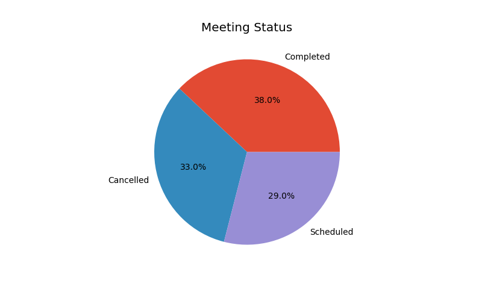
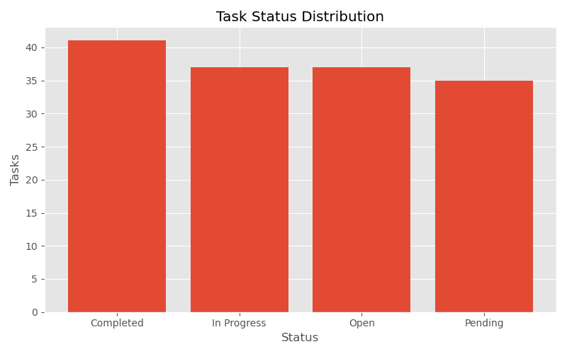
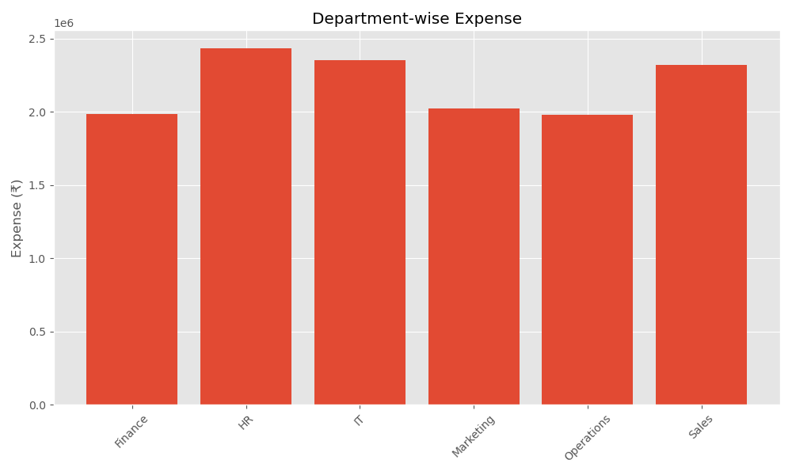

# Executive Assistant Business Dashboard

A multi-page Streamlit business-operations dashboard for reviewing meetings, tasks, follow-ups, vendors, expenses, calendar activity and MIS summaries. The repository includes Excel sample data and report exports.

## Preview

These existing PNG exports provide a visual preview of dashboard analytics; they are chart images, not full-window application screenshots.

### Meeting status


### Task status


### Expense by department


## Run locally

Run these commands from this directory:

```bash
python -m venv .venv
# Windows: .venv\\Scripts\\activate
# macOS/Linux: source .venv/bin/activate
python -m pip install -r requirements.txt
streamlit run streamlit_app.py
```

## Run checks

```bash
python -m pytest -q
```

Tests check the required Excel workbooks, expected tables and columns from the data loader, and the ability to create core charts from sample data. GitHub Actions runs the checks on relevant pushes and pull requests.

## Deploy to Streamlit Community Cloud

1. Sign in to Streamlit Community Cloud and choose **Create app**.
2. Select this repository and the `main` branch after merging the readiness changes.
3. Set the main file path to `Business Project/Executive_Assistant_Business_Dashboard/streamlit_app.py`.
4. Deploy. Once deployment succeeds, add the generated `*.streamlit.app` URL to this README and the repository's top-level README.

A live URL cannot be supplied until the app is actually deployed through a Streamlit account. This update prepares dependencies and documents the entry point; it does not create hosting by itself.

## Notes

- The app loads local Excel workbooks from `data/`.
- Google Sheets workflows may require additional configuration and credentials. Never commit secrets or service-account keys.
- Run a smoke test in Streamlit Cloud after deployment because cloud paths and package versions can differ from a local notebook environment.
